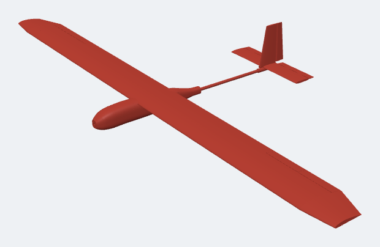
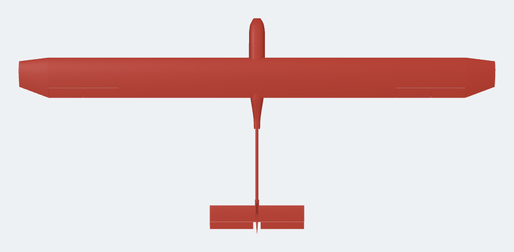
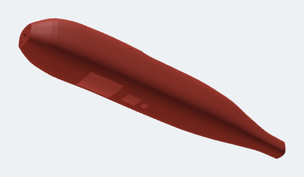

# Modelo 3D — avião solar para imprimir



Planador de **2,6 m de envergadura**, com fuselagem curta impressa e tubo de
carbono até a cauda. A asa tem corda de 220 mm, e em cima dela cabem
**18 células SunPower** (9 por lado). Isso bate com a bateria 2S do
[guia de montagem](../GUIA-MONTAGEM.md).

| Vista de cima | Barriga: janelas da GoPro, LiDAR e câmera térmica |
|---|---|
|  |  |

> ⚠ **Projeto novo, ainda não voado.** As contas de estabilidade e
> equilíbrio estão feitas, mas o primeiro voo é sempre um teste. Siga a
> seção [Primeiros voos](#primeiros-voos) com calma.

---

## Arquivos

| Arquivo | O que é |
|---|---|
| `stl/` | Uma peça por arquivo, já deitada na posição de impressão |
| `montagem.stl` | O avião inteiro montado, só para olhar |
| `pecas.txt` | Lista de peças, peso estimado e equilíbrio |
| `gerar_modelo.py` | O programa que desenha tudo. Mude uma medida e gere de novo |

Para gerar de novo, depois de mudar alguma medida no topo do arquivo:

```
pip install manifold3d numpy
python gerar_modelo.py
```

---

## Números do avião

| | |
|---|---|
| Envergadura | 2.600 mm |
| Área da asa | 0,56 m² |
| Perfil da asa | NACA 4412. Cauda: NACA 0009 |
| Peças impressas | ~1.150 g |
| **Peso em voo** (com bateria, GoPro e eletrônica) | **~2,4 kg** |
| Carga alar | ~43 g/dm² |
| **Centro de gravidade** | **286 mm atrás da parede de fogo** (30% da corda) |
| Para equilibrar | Bateria encostada na frente, mais ~25 g de lastro no nariz |

**Sobre o sol:** voando devagar (~36 km/h), o avião gasta ~35–45 W. As
células dão até ~45 W com sol forte ao meio-dia. Então, nas melhores horas,
o sol cobre quase todo o consumo. Fora delas, ele **aumenta muito a
autonomia**, mas não segura o voo sozinho. Cada grama a menos ajuda: pese as
peças e não exagere na cola.

---

## O que comprar além da eletrônica

| Item | Qtd | Para quê |
|---|---|---|
| Filamento **LW-PLA** (PLA que espuma, ex: colorFabb ou Polymaker) | 1 kg | Asa e cauda. **PLA comum fica pesado demais** |
| Filamento **PETG** | 0,5 kg | Fuselagem e suportes |
| Tubo de carbono **10 × 8 mm**, 1.200 mm | 2 | Longarina principal (um por lado) |
| Vareta de carbono **8 mm**, 400 mm | 1 | Junta os dois lados da asa (entra nos tubos de 10 mm) |
| Tubo de carbono **6 × 4 mm**, 800 mm | 2 | Longarina traseira |
| Tubo de carbono **16 × 14 mm**, 600 mm | 1 | Tubo da cauda |
| Vareta de carbono 4 mm, 550 mm e 2 mm, 150 mm | 1 + 1 | Estabilizador e união dos profundores |
| Vareta de carbono 1,5 mm, 700 mm + tubinho de PTFE | 2 | Comandos do profundor e do leme |
| Servo 9 g com engrenagem de metal (ex: MG90S) | 4 | 2 ailerons + profundor + leme |
| Vareta de 5 mm (carbono ou madeira), 120 mm | 2 | Para os elásticos que prendem a asa |
| Elásticos grossos de látex | 6–8 | Prendem a asa (soltam num choque, protegendo a asa) |
| Fita para dobradiça (ex: Blenderm, ou fita transparente reforçada) | 1 | Dobradiças das partes móveis |
| Chifres de comando, garfinhos (clevis) e extensões de servo | 1 kit | |
| Cola instantânea (CA) + ativador, e epóxi 5 min | 1 + 1 | CA nas peças, epóxi nas longarinas |

---

## Como imprimir

### Asa e cauda: LW-PLA

| Ajuste | Valor |
|---|---|
| Posição | Em pé, como o arquivo já vem (perfil na mesa) |
| Temperatura | ~230–245 °C (o LW-PLA espuma e rende mais) |
| Fluxo | ~45–55%. Calibre com o cubo de teste do fabricante |
| Perímetros | **1** |
| Camadas de cima e de baixo | 1 (formam as nervuras das pontas, onde vai a cola) |
| Preenchimento | 3% giroide |
| Camada | 0,25 mm |
| Retração | Mínima ou nenhuma (o LW-PLA escorre). Costura alinhada no bordo de fuga |

Imprima um segmento primeiro, pese e compare com o `pecas.txt` (~49 g).
Se passar de 60 g, baixe o fluxo.

### Fuselagem e suportes: PETG

| Ajuste | Valor |
|---|---|
| Fuselagem | Em pé, com a face do corte na mesa (o arquivo já vem assim). 4 perímetros, 0% de preenchimento: as paredes do desenho já têm 1,6 mm |
| Suportes e bandeja | 3 perímetros, 20% de preenchimento |
| Suporte de impressão | Não precisa |

**Impressora:** mesa de 220 × 220 mm (os segmentos da asa vão na
diagonal) e **pelo menos 240 mm de altura**. Se a sua for mais baixa,
diminua `SEGMENTO` e `PROFUNDOR_METADE` no programa e gere de novo.

### Lista de peças

| Arquivo | Qtd |
|---|---|
| `asa_segmento_A_raiz.stl` | 8 (4 por lado, do centro para fora) |
| `asa_segmento_B_servo.stl` | 2 (5º segmento: servo do aileron) |
| `asa_segmento_C.stl` | 2 (6º segmento) |
| `asa_ponta_esquerda.stl` e `asa_ponta_direita.stl` | 1 + 1 |
| `aileron.stl` | 4 (2 por lado) |
| `cauda_estabilizador.stl` / `cauda_profundor.stl` | 2 / 2 |
| `cauda_deriva.stl` / `cauda_leme.stl` | 1 / 1 |
| `fuselagem_1_nariz.stl`, `_2_meio.stl`, `_3_cauda.stl` | 1 de cada |
| `suporte_cauda.stl` | 1 |
| `suporte_gopro.stl`, `berco_lidar.stl`, `bandeja_eletronica.stl` | 1 de cada |

---

## Como montar

### Asa (faça um lado de cada vez)

1. Lixe de leve as faces das pontas de cada segmento.
2. Passe o **tubo de 10 mm** pelos segmentos A, A, A, A, B e C, nessa
   ordem, e o **tubo de 6 mm** pelos quatro segmentos A. Deixe 50 mm do
   tubo de 10 mm sobrando para o lado do centro.
3. Cole os segmentos com CA, um de cada vez, apertando sobre uma mesa
   **reta**. Uma asa torta voa torta.
4. Cole a ponta no segmento C.
5. Passe os fios do servo pelo **furo de 8 mm** (tubo dos fios) até o
   alojamento no segmento B. Cole o servo.
6. Coloque os ailerons com fita de dobradiça **em cima**: o chanfro fica
   embaixo e deixa o aileron subir e descer.
7. Cole as **células solares** em cima, de 15% a 72% da corda, seguindo o
   [guia de montagem](../GUIA-MONTAGEM.md#fase-4--placas-solares).
8. Para juntar os dois lados, a vareta de 8 mm entra nos tubos de 10 mm
   dos dois lados. Assim a asa desmonta para transportar.

### Fuselagem

1. Cole as três peças (nariz, meio e cauda). O anel de cada peça entra
   na seguinte.
2. Parafuse o motor na **parede de fogo** (furos M3 de 16 e 19 mm).
3. Cole o **tubo de 16 mm** na luva da cauda com epóxi, bem alinhado.
4. Passe as varetas dos comandos pelos furos de 3,2 mm do cone da cauda.
5. Coloque as duas varetas de 5 mm nos furos laterais, para os elásticos.

### Cauda

1. Passe a vareta de 4 mm pelo `suporte_cauda` e pelos dois
   estabilizadores. Cole tudo, **em esquadro** com a asa.
2. Cole a deriva em cima do suporte.
3. Una os dois profundores com a vareta de 2 mm e coloque as dobradiças.
   Faça o mesmo com o leme.
4. Encaixe o suporte no tubo, alinhado com a asa vista de frente, e cole.

### Dentro da fuselagem (da frente para trás)

| Posição (mm da parede de fogo) | O quê |
|---|---|
| 15–85 | Bateria 2S3P, **encostada na frente** |
| 120–190 | GoPro com a lente virada para a janela da barriga, presa no `suporte_gopro` |
| 210–240 | LiDAR no `berco_lidar`, olhando pela janela pequena |
| 255 | Câmera térmica MLX90640 no furo redondo, olhando para baixo |
| 220–360 | `bandeja_eletronica` com controladora, TTGO, MPPT, ESC e receptor (com velcro) |

O GPS vai **em cima da asa**, no centro, longe dos fios de energia.

---

## Primeiros voos

1. **Equilíbrio:** com tudo montado, apoie o avião com os dedos embaixo
   da asa, a **286 mm da parede de fogo**. Ele deve ficar reto ou com o
   nariz levemente para baixo. Mexa a bateria e, se precisar, ponha
   lastro no nariz.
2. **Comandos:** confira se tudo mexe para o lado certo, ~15 mm para cada
   lado nos ailerons e no profundor.
3. **Lançamento planado:** sobre grama alta, com o motor desligado, lance
   reto e firme. O avião deve planar reto e descer suave. Se subir e
   estolar, falta peso no nariz. Se mergulhar, sobra.
4. Só então faça o primeiro voo com motor, em **FBWA**, num dia sem vento.
5. Depois faça o **AUTOTUNE** do ArduPilot antes de voar em AUTO.
